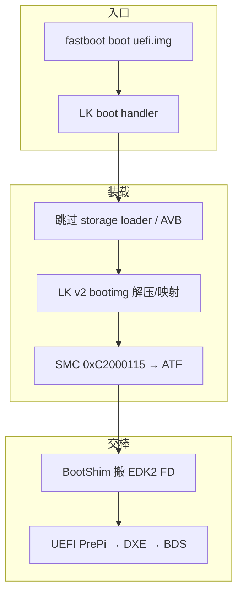
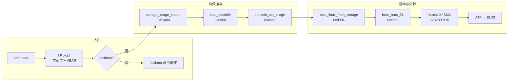
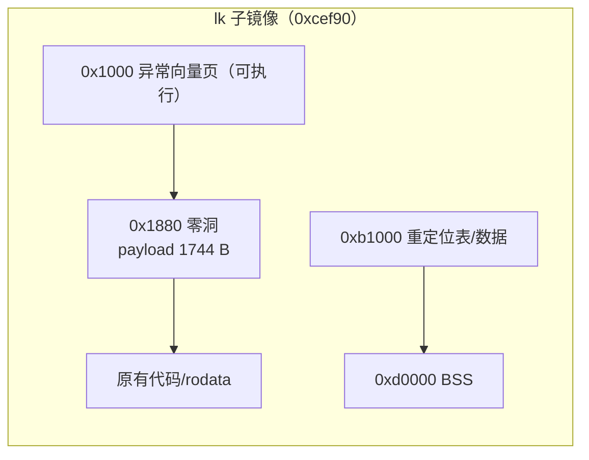
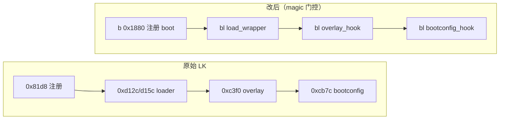
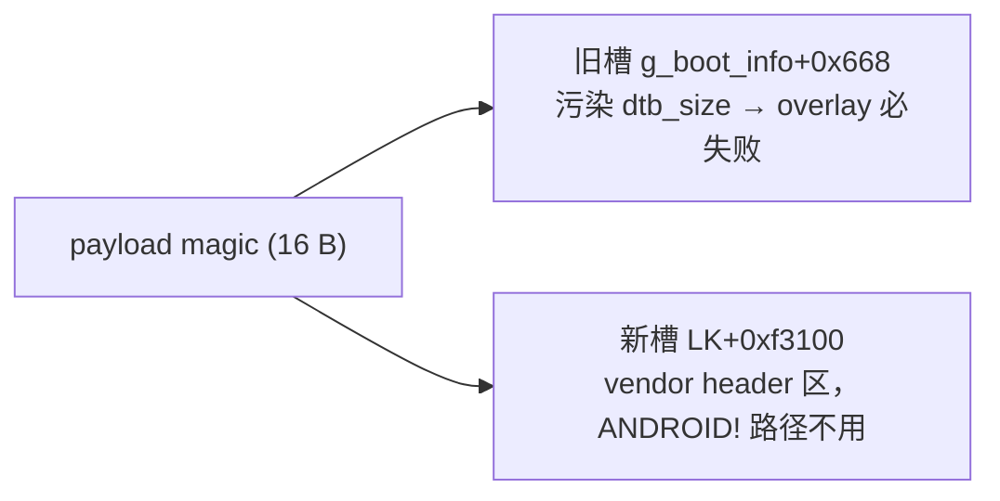
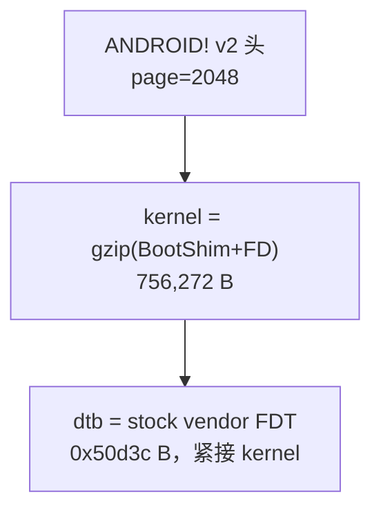
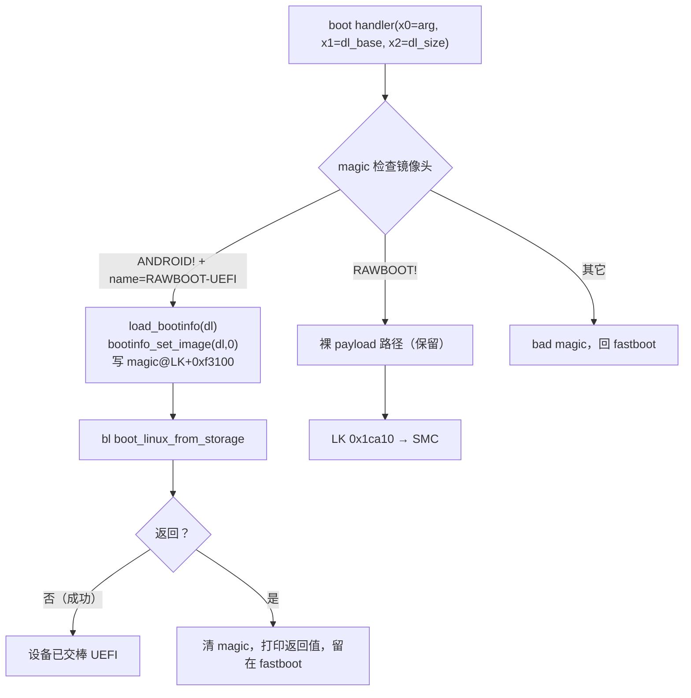
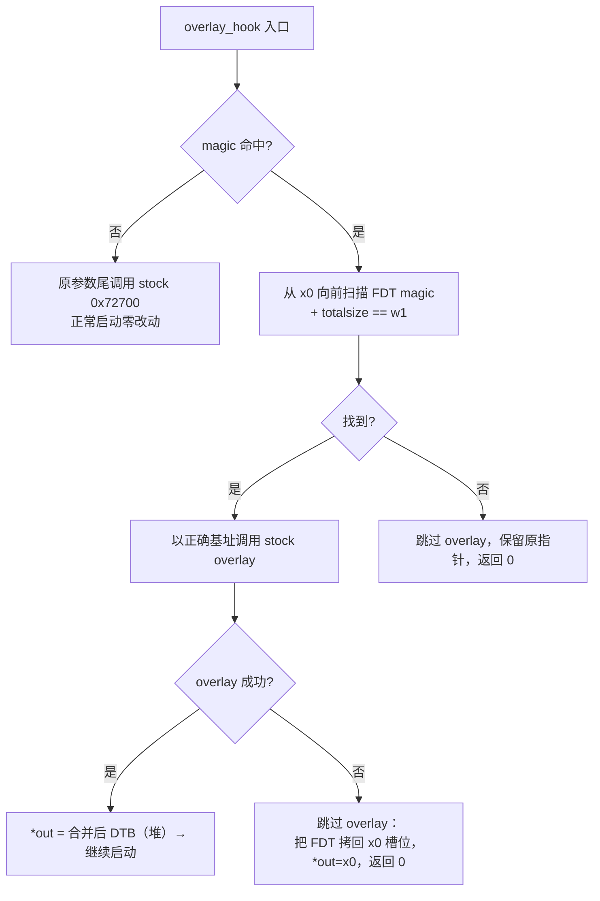
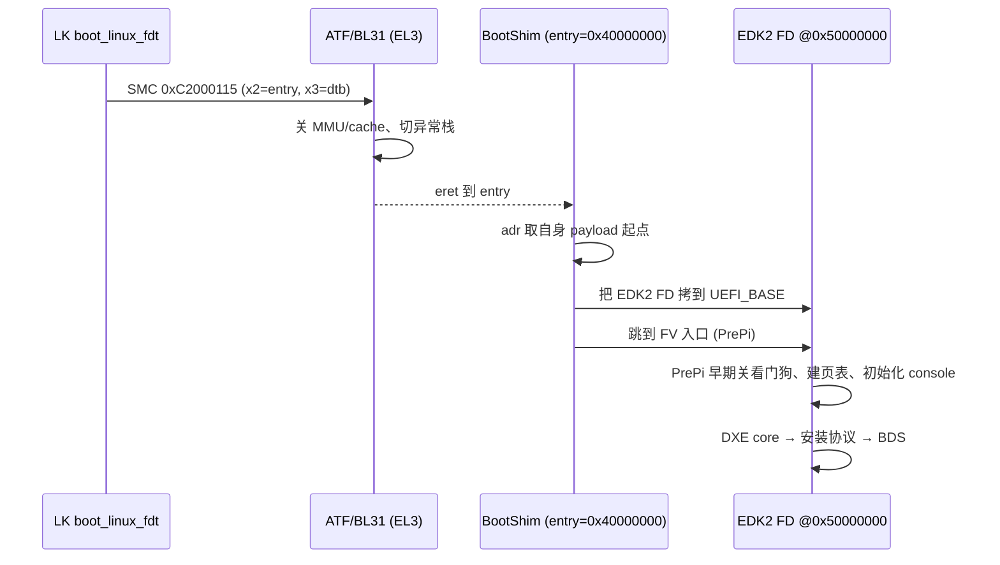
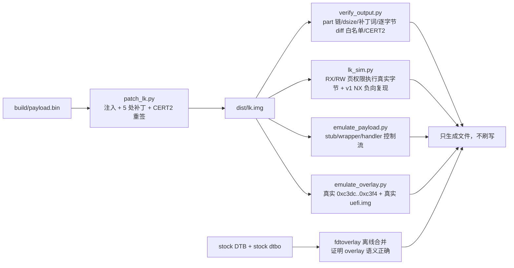

# iQOO Z8：给 LK 加 `fastboot boot` 并从内存启动 UEFI

iQOO Z8（MT6896，OriginOS 3）上的 LK 改造记录。目标是让 locked 设备通过
`fastboot boot` 从内存启动 EDK2 UEFI，不写 boot/vendor_boot 分区，失败可重启恢复。

结果：LK v5 + 合法 v2 boot image 走通，UEFI 进入 DXE。

本仓库不包含厂商 `lk.bin`、UEFI FD、签名密钥或签名工具。



## 1. LK 结构

LK 是 MTK MKIMG 容器，子镜像顺序：

```
lk / cert1 / cert2 / bl2_ext / cert1 / cert2 /
aee / cert1 / cert2 / lk_main_dtb / cert1 / cert2
```

`lk` 子镜像参数：

| 项 | 值 |
|---|---|
| dsize | 0xcef90 |
| BSS | 0xd0000 |
| 分区 | 16 MiB |
| 运行时 | PIE，VA = LK_base + offset |

运行时偏移直接当链接地址用。镜像自带重定位表（0xb1000），入口负责修正绝对地址，
注入的代码必须位置无关，只用 `adr` 和相对跳转。

启动链：

```
preloader → LK → storage_image_loader(0x51a04)
→ load_bootinfo_from_hdr(0x9d00) → bootinfo_set_image(0xa6ec)
→ boot_linux_from_storage(0xd0d4) → boot_linux_fdt(0xc0bc)
→ SMC 0xC2000115 → ATF → BL33
```



所有改动只涉及两处：fastboot 命令注册，和 `boot_linux_fdt` 内部。

## 2. payload 注入

payload 不能放数据区。v1 把它放在 lk 数据尾部 `0xcef90`，签名正常，真机取指即崩：

```
[SEC] lk cert chain vfy pass
instruction abort: PC at 0xffff0000800cef90
panic (caller 0xffff00008000125c): die
```

原因是数据页被映射为 NX。可用的位置是与异常向量同页的零洞 `0x1880..0x2400`，
v5 payload 占 1744 B，dsize 不变。

| 符号 | 偏移 |
|---|---:|
| stub（补注册 + 注册 boot） | 0x1880 |
| load_wrapper（跳过 storage loader） | 0x18a8 |
| overlay_hook | 0x18f8 |
| memmove_up | 0x1a3c |
| bootconfig_hook | 0x1a78 |
| boot_handler | 0x1acc |
| magic | 0x1f40 |



## 3. 五处补丁

| 偏移 | 原指令 | 改为 | 作用 |
|---|---|---|---|
| 0x81d8 | `b fastboot_register` | `b 0x1880` | 补回 ultraflash 注册，再注册 `boot` |
| 0xd12c | `bl storage_image_loader` | `bl load_wrapper` | recovery 路径跳过 loader |
| 0xd15c | `bl storage_image_loader` | `bl load_wrapper` | boot 路径跳过 loader |
| 0xc3f0 | `bl 0x72700` | `bl overlay_hook` | dtbo overlay 门控 |
| 0xcb7c | `bl 0xadd4` | `bl bootconfig_hook` | 跳过 bootconfig 追加 |

`boot` 命令节点的 flags 设为 (1,0)，在 locked + secure 下仍可用。原 6 条命令不变。



跳过 storage loader 有两个原因：locked 设备的 AVB 会校验被改过的 boot_b，
`avb_slot_verify` 返回 NULL 后 LK 在 0x16dbc 直接解引用崩溃；同时它加载的
vendor ramdisk 地址在 fastboot 路径下没有映射。

## 4. magic 槽位

跨函数状态用一个 16 字节 magic。最初的槽位是 `g_boot_info+0x668`，理由是
该处代码不访问。这个判断是错的，v2 头尾部字段如下：

```
+0x660  recovery_dtbo_size
+0x664  recovery_dtbo_offset
+0x66c  header_size
+0x670  dtb_size        <- 被 magic 覆盖
+0x674  dtb_addr
```

16 字节 magic 把 `dtb_size` 写成 ASCII `-BOO`，即 0x4F4F422D。overlay 检查
`[base+4] == dtb_size` 永远失败：

```
dtbo_size=227423
ERROR: ufdt_apply_overlay():Bad fdt size!
ASSERT FAILED at (app/mt_boot/mt_boot.c:587): err == NO_ERROR
```

此时换 DTB、改偏移都无效。定位方法是读 `boot_linux_fdt` 的 v2 分支反汇编，
并在钩子里打印 LK 传入的 base/size。

v4 起 magic 放在 `LK+0xf3100`（vendor_boot 头拷贝区 +0x258）。`ANDROID!` 镜像
不写这块，正常启动也不写 magic，读取时不会误命中。



## 5. boot image

直接跳 BL33 不可行，实测两种方式都失败：原地执行下载缓冲，屏幕无输出后复位；
复制到 0x40080000，低地址和高线性 VA 都没有页表，写 fault。

最终改为构造合法 v2 boot image，让 LK 自己完成解析、解压、映射和 SMC：

```
ANDROID! v2, page=2048
kernel      = gzip(BootShim + EDK2 FD)   756,272 B -> 7,340,256 B
kernel_addr = 0x40000000
ramdisk_size= 0, ramdisk_addr = 0x51000000
dtb         = stock vendor DTB, 0x50d3c B, dtb_addr=0x47c80000
name        = RAWBOOT-UEFI
```



字段约束都来自 LK 的断言和真机日志：

| 字段 | 要求 | 不满足时 |
|---|---|---|
| `kernel_addr` | 0x40000000 | `mb_kernel` 分配 0x7c80000 失败，`mt_boot.c:622` 断言 |
| `ramdisk_addr` | 非 0 | `mt_boot.c:890 ramdisk_target_addr != 0` 断言 |
| DTB 偏移 | `page + align(kernel_size)` | `no fdt for overlay` |
| `dtb_size` | 等于 DTB totalsize | `Bad fdt size` |
| `name` | `RAWBOOT-` 前缀 | 进不了 bootimg 分支 |

`boot` handler 流程：

```
magic 检查 → RAWBOOT! 裸镜像走原 SMC 路径
           → ANDROID! + RAWBOOT- 前缀：
               load_bootinfo(download)
               bootinfo_set_image(download, 0)
               写 magic
               boot_linux_from_storage()
```



## 6. overlay 与 bootconfig

`boot_linux_fdt` 在加载 `dtbo_a` 后调用 0x72700，参数：

```
x0 = base fdt   w1 = base size
x2 = overlay    w3 = overlay size
x4 = &out
```

钩子只在 magic 命中时介入：向前扫描 FDT magic 和 `totalsize == w1`，用正确基址
调用原函数；失败则跳过，并把 FDT 拷贝到 LK 原来的槽位。后者是必须的，因为
调用者在 overlay 之后会 `free(*out)`，指向镜像内部的指针不能直接交回去。

正常启动（magic 未命中）原参数尾调用 0x72700。



bootconfig 追加在 0xcb7c，目标是 `0xffff000066f00000 + vendor_ramdisk_size`。
fastboot 路径没有加载 vendor ramdisk，该地址没有映射，实测：

```
data fault: PC at 0xffff00008006bf6c, FAR 0xffff000066f00000, iss 0x46
```

0x6bf6c 是 LK 的 memcpy。钩子在 magic 命中时返回 0（追加 0 字节），调用者的
`linux,initrd-end` 保持原值；正常启动尾调用 0xadd4。

## 7. 交棒 UEFI

LK 在 `boot_linux_fdt` 末尾调用 0x1ca10：quiesce、关 cache、VA 转 PA、
trampoline，然后在 0xd0c8 执行：

```
mov x4, #1
smc #0xC2000115
```

参数：

```
x1 = 0xC2000115
x2 = entry（boot header 的 kernel_addr）
x3 = DTB 物理地址
```

ATF 返回后 MMU/cache 关闭，执行 BootShim。BootShim 搬运 FD 到 0x50000000，
跳到 FV 入口（PrePi 0x500085A0）。BootShim 头部带 arm64 Linux Image 头，
因此可以被 LK 当内核处理。



UEFI 侧需要处理：

- 12 GiB 内存图按真实 mblock 重建，避开 gz/mkp/BL31-reserved/aee_lk/framebuffer；
- PrePi 最早期关看门狗（0x1C007000），否则约 30 秒复位；
- framebuffer 用 LK 的 0xFE20F000 / 1088×2388，DXE 日志直接上屏；
- 首版去掉 UFS/SCSI/ext4，先验证到 BDS。

屏幕出现 `InstallProtocolInterface: 387477C2-…`（SimpleTextOut）等日志，
说明已在 DXE 阶段。

启动后设备管理器里可能仍能看到 `0e8d:201c`，这是 LK 初始化过的 fastboot
USB 接口，不是 UEFI 的 adb。LK 交棒后控制器没有复位，描述符仍然存在；
UEFI 并未接管 USB，所以 adb/fastboot 都不响应。拔插线会复位该接口，
而 UEFI 不重新枚举，端口就消失。需要时只能重启回 fastboot 重新 boot。
要在 UEFI 里用 adb，需要另行移植 UDC/USB 栈和 gadget 应用。

## 8. 验证

真机刷写成本高，主要问题先在本地排掉：

- `verify_output.py`：part 链、dsize、补丁字、CERT2、未改子分区哈希；
  lk 数据区的字节差异必须在“补丁字 + 注入洞”白名单内。
- `lk_sim.py`：按 RX/RW 页权限执行成品真实字节；v1 的 0xcef90 负向用例
  必须报 `UC_ERR_FETCH_PROT`。
- `emulate_payload.py`：stub/wrapper/handler/bootconfig 的控制流与参数。
- `emulate_overlay.py`：执行真实 0xc3dc..0xc3f4 调用点 + 真实 uefi.img，
  覆盖正常放行、基址修正、overlay 失败回退、无 FDT。
- `fdtoverlay`：离线确认 stock DTB + stock dtbo 可合并。



真机看 expdb：

| 日志 | 含义 |
|---|---|
| `skip storage loader (bootimg magic)` | loader 已跳过 |
| `kernel_sz=0x000b8a30` | 读到 gzip kernel |
| `mblock_alloc ... name:mb_dtb` | DTB 区 0x47c80000 分配成功 |
| `overlay base=0x… size=0x…` | 钩子看到的 LK 入参 |
| `after overlay, fdt size(558491)` | stock overlay 成功 |
| `mblock_alloc ... name:mb_kernel` | 内核区分配成功 |
| `decompress kernel image...` | gzip 解压 |
| `bootconfig skipped` | 跳过 bootconfig，下一步进 SMC |

host 端 `fastboot boot` 停在 `Booting` 不返回是正常现象：LK 交棒后不再回
fastboot 协议，UEFI 保持 USB 时 host 也等不到断开。Ctrl+C 即可。

## 9. 版本

| 版本 | 改动 | 结果 |
|---|---|---|
| v1 | payload 放 0xcef90 | NX 取指崩溃 |
| v2 | 移到 0x1880，boot 可用 | storage loader AVB 崩溃 |
| v3 | 裸 RAWBOOT + 原地 SMC | BL33 入口被拒 |
| v3c/v3d | 复制到 0x40080000 / vmm_get_va | 高低地址均未映射 |
| v3e | 改走合法 v2 boot image | 卡 dtbo overlay |
| v3f | overlay 钩子 | magic 污染 dtb_size，仍失败 |
| v4 | magic 迁到 0xf3100；kernel_addr=0x40000000 | overlay/解压通过，卡 bootconfig |
| v5 | bootconfig 钩子 | UEFI 启动，进入 DXE |

## 10. 移植到其他 LK

1. 确认容器、dsize/BSS、重定位表，找可执行零洞。
2. 定位 `fastboot_register`、命令注册尾调用、`storage_image_loader` 调用点、
   `boot_linux_fdt`、最终 SMC 函数。参数顺序按反汇编确认，不要按文档猜。
3. 选 magic 槽位。反汇编确认无引用，且不在任何启动路径读取的结构体内。
4. 构造 boot image。`kernel_addr`、DTB 偏移、`dtb_size`、`ramdisk_addr`
   按目标 LK 的断言和 mblock 布局确定。不确定时在钩子里打印 LK 传入的值。
5. 检查 `boot_linux_fdt` 中依赖 storage loader 副作用的写操作：overlay 基址、
   bootconfig/initrd 目标地址，逐个加门控。
6. 移植 BootShim/FD：入口地址、FD 目标、内存 carveout、看门狗。
7. 先仿真并保留 recovery 通道，再刷 lk_a。

## 11. 说明

- 仓库只包含脚本、payload 源码、文档和哈希，不含固件与签名工具。
- 操作对象应为自有或已授权设备。修改 bootloader 有变砖和数据损失风险。
